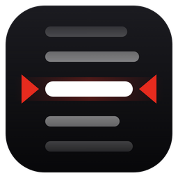
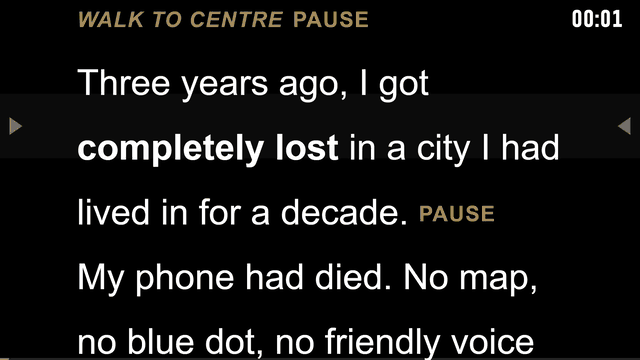
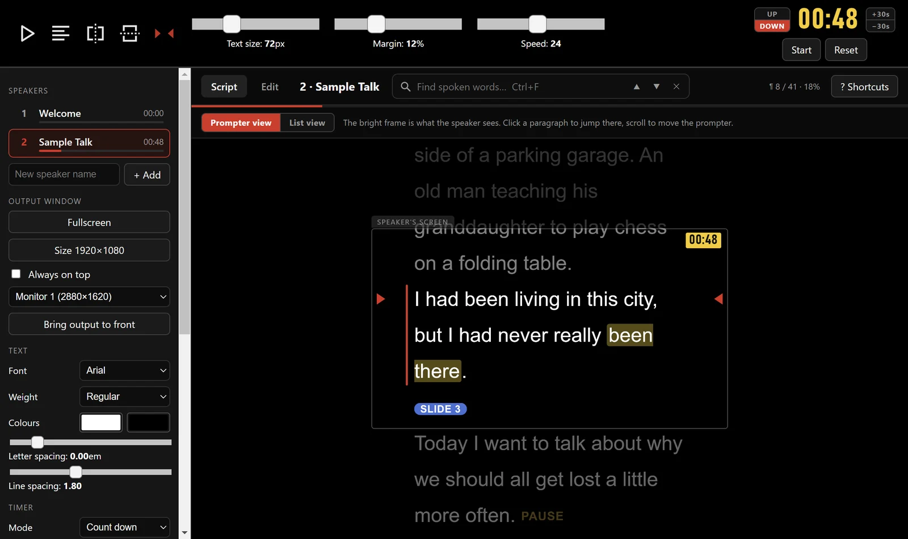
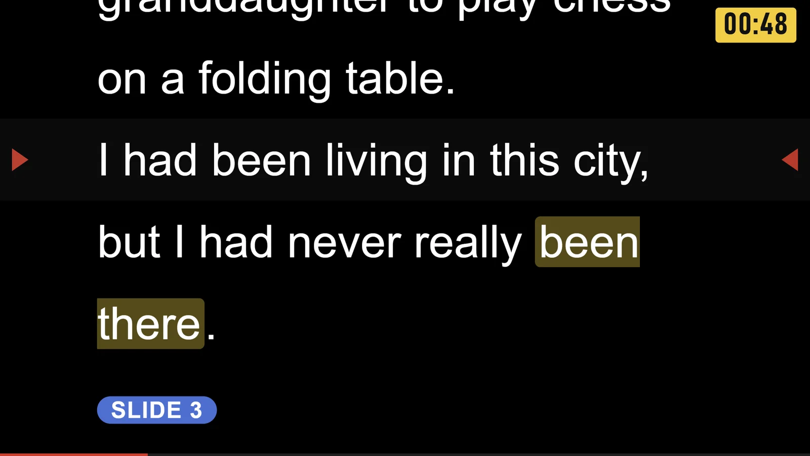

<p align="center">
  
</p>

<h1 align="center">GlidePrompter</h1>

<p align="center">
  <b>A smooth, free teleprompter for live talks, streams and recordings.</b><br>
  One window for the speaker (or OBS), one for the operator, and a profile for every speaker.
</p>

<p align="center">
  <a href="https://github.com/AmineChr54/glideprompter/releases/latest/download/GlidePrompter.exe"><b>⬇ Download for Windows</b></a> ·
  <a href="https://aminechr54.github.io/glideprompter/app/"><b>▶ Run it in your browser</b></a> ·
  <a href="https://aminechr54.github.io/glideprompter/">Website</a>
</p>

<p align="center">
  
</p>

---

## Contents

- [Features](#features)
- [Download & run](#download--run)
- [Web version](#web-version)
- [The two windows](#the-two-windows)
- [Scripts](#scripts)
- [Formatting & cues](#formatting--cues)
- [Timer](#timer)
- [Finding your place (search)](#finding-your-place-search)
- [Using it with OBS or a stage monitor](#using-it-with-obs-or-a-stage-monitor)
- [Keyboard shortcuts](#keyboard-shortcuts)
- [Settings & profiles](#settings--profiles)
- [Build from source](#build-from-source)
- [Project layout](#project-layout)
- [License](#license)

## Features

- **Smooth scrolling.** The script moves on the GPU in a single animation loop. Play, pause and speed changes ease in and out. Tap the arrow keys to nudge the text by a line, or hold them to glide.
- **Two windows.** The *Output* window shows only the text, the reading line and the timer. The *Control* window has everything else.
- **Prompter view.** The Control window shows a live miniature of the speaker's screen, with the same font and the same line breaks. A frame marks what the speaker currently sees, with the script before and after it.
- **Per-speaker profiles.** Every speaker keeps their own text size, colours, font, margins, speed, mirroring, timer settings and exact position. Press <kbd>Ctrl</kbd>+<kbd>1</kbd>…<kbd>9</kbd> to switch.
- **Fonts.** Choose the font family, weight, letter spacing, line spacing, text and background colour, and the alignment.
- **Inline formatting.** Mark words **bold**, *italic*, underlined, highlighted or coloured, with a toolbar and shortcuts in the editor.
- **Count up / count down timer.** Each speaker has a target time and a warning window (yellow). The timer turns red at zero and can count overtime (`-00:12`). Choose its corner and colours, click it to type a time, or nudge it by ±30 s.
- **Word search.** Type what the speaker just said and press <kbd>Enter</kbd>. The prompter glides so those words land on the reading line.
- **Stage cues.** `[PAUSE]`, `[SLIDE 3]` and similar cues are styled so they're never read out.
- **Mirror modes** for beam-splitter glass, horizontally and/or vertically.
- **Built-in editor** with undo/redo, a word count, the estimated speaking time and the scroll time at the current speed.
- **OBS-friendly.** The desktop app keeps rendering at full frame rate even when it's covered or unfocused.
- **Portable.** It's a single `.exe` with no installer and needs no internet.

| Control window (Prompter view) | Output window |
|---|---|
|  |  |

## Download & run

1. Download **[`GlidePrompter.exe`](https://github.com/AmineChr54/glideprompter/releases/latest/download/GlidePrompter.exe)** from the [latest release](https://github.com/AmineChr54/glideprompter/releases/latest).
2. Put it in any folder and double-click it.
   Windows may show *"Windows protected your PC"*. Click **More info → Run anyway**. The app is not code-signed.
3. The first time it runs, it creates a **`GlidePrompter Scripts`** folder next to the `.exe` with two sample scripts. Your scripts and saved settings (`profiles.json`) live in that folder. If the folder next to the `.exe` isn't writable, it uses `Documents\GlidePrompter Scripts` instead.

It runs on Windows 10 and 11 (x64).

## Web version

**[aminechr54.github.io/glideprompter/app](https://aminechr54.github.io/glideprompter/app/)** runs the same app in Chrome, Edge or Firefox, with nothing to install.

- The page you open is the **Control** window. Click **Open prompter window** to open the **Output** window as a pop-up. If nothing opens, allow pop-ups for the site.
- Scripts are stored **in your browser**. Use **Import .txt scripts…** to add files, and **Download this script** to save one back to disk.
- Fullscreen: click the prompter window and press <kbd>F</kbd>, or double-click it. Browsers only allow fullscreen from inside that window.
- **Keep the prompter window visible.** Browsers pause windows that are minimised or completely covered, and the Control window shows a warning when that happens. Use a second screen, or put the two windows side by side.

Use the desktop app when you need guaranteed smooth output behind other windows, a fullscreen output on a specific monitor, "always on top" or an exact 1920×1080 size.

## The two windows

| Window | What it's for |
|---|---|
| **GlidePrompter Output** | What the speaker sees: the text, a red reading line, the timer and a thin progress bar. Put it on the stage screen or capture it in OBS. |
| **GlidePrompter Control** | The toolbar (play, alignment, mirroring, reading line, text size, margin, speed, timer), the speaker list, all settings, the **Script** tab and the **Edit** tab. |

The **Script** tab has two views:

- **Prompter view** is an exact miniature of the Output window. The framed area is what's on the speaker's screen right now, and past text is dimmed. Click a paragraph to jump there, or scroll to move the prompter.
- **List view** shows the whole script as paragraphs, with the current one highlighted.

Closing either window quits the app. Position, timer and settings are saved first.

## Scripts

Every speaker is one plain-text file in the scripts folder.

- **One line = one paragraph.** Lines that end in `<br>` (CuePrompter's paste format) work too, and the app saves in that format.
- **The file name sets the order and the name:** `3_Jane_Doe.txt` shows as **3 · Jane Doe** and gets <kbd>Ctrl</kbd>+<kbd>3</kbd>. A trailing version tag such as `_v2` is hidden.
- Add a speaker with the **New speaker name** box, or drop a `.txt` file into the folder. The app watches the folder and picks up changes, including edits made in another editor.
- **Change scripts folder…** points the app at any other folder.

## Formatting & cues

Type this in the editor, or select text and use the toolbar or shortcuts:

| You type | On the prompter | Shortcut |
|---|---|---|
| `**really**` | **really** | <kbd>Ctrl</kbd>+<kbd>B</kbd> |
| `*slowly*` | *slowly* | <kbd>Ctrl</kbd>+<kbd>I</kbd> |
| `__never__` | <ins>never</ins> | <kbd>Ctrl</kbd>+<kbd>U</kbd> |
| `==been there==` | highlighted | <kbd>Ctrl</kbd>+<kbd>Shift</kbd>+<kbd>H</kbd> |
| `{orange}unexpected{/}` | coloured text | colour menu |
| `{#ff8800}any hex colour{/}` | coloured text | |
| `[PAUSE]` `[BREATHE]` `[SMILE]` | small coloured cue | cue menu |
| `[SLIDE 3]` | blue slide badge | cue menu |

The named colours are `red`, `orange`, `yellow`, `green`, `blue`, `purple`, `white` and `gray`. Cues starting with PAUSE, WAIT, BREATHE, BEAT or SILENCE are yellow, other cues are orange, and SLIDE cues are blue badges.

Below the editor you see the word count, the estimated speaking time at 130 words per minute, and how long the scroll takes at the current speed. Save with <kbd>Ctrl</kbd>+<kbd>S</kbd>. The prompter keeps the same words on the reading line after saving.

## Timer

Each speaker has their own timer, and its settings are in the **Timer** section of the sidebar:

| Setting | What it does |
|---|---|
| **Mode** | *Count up* (elapsed time) or *Count down* (time left until the target). You can also use the UP / DOWN switch next to the toolbar timer. |
| **Target time** | Where the countdown starts. In count-up mode the timer turns red after this time. `00:00` turns the colours off. |
| **Warn before** | How many seconds before the target the timer turns **yellow** (default 60). |
| **Count overtime** | After zero the countdown continues as `-00:12`. Turn it off to stop at `00:00`. |
| **Position / colours / size** | Choose the corner, the text and background colour, and the size. You can also hide the timer. |

- **Start / stop** with <kbd>T</kbd> and **reset** with <kbd>Shift</kbd>+<kbd>T</kbd>.
- **Click the time** in the toolbar to type a new one (`5:30`, `-0:20` or `90`) and press <kbd>Enter</kbd>.
- **+30s / −30s** always make the displayed number bigger or smaller, in either mode.
- Switching speakers pauses the running timer. Each speaker's time is saved.

## Finding your place (search)

Press <kbd>Ctrl</kbd>+<kbd>F</kbd> and type a few words you just heard. Capitals, accents and punctuation don't matter, so `dont know` finds "don't know".

- As you type, matches are highlighted in the Control window, but the prompter doesn't move yet.
- <kbd>Enter</kbd> glides the prompter so that match sits on the reading line. It starts with the first match at or after the current position.
- Press <kbd>Enter</kbd> again for the next match and <kbd>Shift</kbd>+<kbd>Enter</kbd> for the previous one. <kbd>Esc</kbd> clears the search.

## Using it with OBS or a stage monitor

**OBS:** Add a **Window Capture** source, pick **"[GlidePrompter.exe]: GlidePrompter Output"**, and set the capture method to **Windows 10 (1903 and up)**.
You can then minimise OBS and work in the Control window. The Output window keeps rendering even when it's covered or unfocused. Don't *minimise* the Output window itself, because Windows can't capture minimised windows.
**Size 1920×1080** resizes the Output window to exactly 1080p pixels.

**Stage monitor:** Choose the monitor in the sidebar, then click **Fullscreen** (or press <kbd>F</kbd>). **Always on top** keeps the Output window above other windows.

**Glass teleprompter:** Press <kbd>H</kbd> to mirror horizontally (and <kbd>V</kbd> for vertically).

## Keyboard shortcuts

The shortcuts work in both windows. Press <kbd>?</kbd> in the app for this list.

| Key | Action |
|---|---|
| <kbd>Space</kbd> | Play / pause |
| <kbd>↑</kbd> / <kbd>↓</kbd> | Smooth nudge back / forward (hold to glide) |
| <kbd>Shift</kbd>+<kbd>↑</kbd> / <kbd>↓</kbd> | Speed +1 / −1 |
| <kbd>PgUp</kbd> / <kbd>PgDn</kbd> | Previous / next paragraph |
| <kbd>Home</kbd> / <kbd>End</kbd> | Start / end |
| <kbd>T</kbd> / <kbd>Shift</kbd>+<kbd>T</kbd> | Timer start-stop / reset |
| <kbd>+</kbd> / <kbd>−</kbd> | Text size |
| <kbd>,</kbd> / <kbd>.</kbd> (or <kbd>[</kbd> / <kbd>]</kbd>) | Margin |
| <kbd>L</kbd> / <kbd>P</kbd> | Reading line / progress bar |
| <kbd>H</kbd> / <kbd>V</kbd> | Mirror horizontal / vertical |
| <kbd>A</kbd> | Align left / centre |
| <kbd>F</kbd> | Output fullscreen |
| <kbd>Ctrl</kbd>+<kbd>F</kbd> | Search for words the speaker said |
| <kbd>Enter</kbd> / <kbd>Shift</kbd>+<kbd>Enter</kbd> | Jump to the next / previous match (also <kbd>F3</kbd>) |
| <kbd>Ctrl</kbd>+<kbd>1</kbd>…<kbd>9</kbd> | Switch to speaker N |
| <kbd>Ctrl</kbd>+<kbd>S</kbd> | Save the script (editor) |
| <kbd>Ctrl</kbd>+<kbd>B</kbd> / <kbd>I</kbd> / <kbd>U</kbd> | Bold / italic / underline (editor) |
| <kbd>Ctrl</kbd>+<kbd>Shift</kbd>+<kbd>H</kbd> | Highlight (editor) |
| <kbd>Esc</kbd> | Pause / leave a text field |
| <kbd>?</kbd> | Show all shortcuts |

## Settings & profiles

- **Look settings** are saved per speaker: size, margin, speed, colours, font, weight, letter and line spacing, alignment, mirroring, reading-line position, progress bar and all timer options.
- **Save look as default** makes the current speaker's look the default for every speaker who hasn't changed their own.
- **Reset look to default** removes the current speaker's own settings.
- The reading position, timer and progress of every speaker are saved continuously, so you can close the app mid-talk and pick up where you left off.
- The desktop app stores all of this in `profiles.json` inside the scripts folder. The web version keeps it in browser storage.

## Build from source

It needs [Node.js](https://nodejs.org/) 18 or newer.

```bash
git clone https://github.com/AmineChr54/glideprompter.git
cd glideprompter
npm install
npm start          # run the desktop app (scripts live in ./scripts, seeded with the samples)
npm run dist       # build dist/GlidePrompter.exe (portable, Windows x64)
npm run web        # rebuild the browser version into docs/app/
```

On Windows, `start.bat` installs the dependencies on first run and starts the app.

**Build notes for Windows:**
- `build.win.signAndEditExecutable` is `false`, which avoids the winCodeSign archive that needs admin rights to extract its symlinks.
- If electron-builder fails while renaming its NSIS cache with *Access is denied* (usually antivirus), rename `%LOCALAPPDATA%\electron-builder\Cache\nsis\<number>` to `nsis-3.0.4.1` and build again.

## Project layout

```
main.js            Electron main process: windows, scripts folder, profiles, IPC
preload.js         Safe bridge between the windows and the main process
output.*           Output window (renders and scrolls the script, owns the timer)
control.*          Control window (toolbar, speakers, prompter / list view, editor, settings)
shared/            Code shared by both windows and the web version
  parse.js         Script format, formatting markup, cues, accent-insensitive search
  keys.js          Keyboard shortcuts
  timer.js         Count up / count down display rules
  defaults.js      Default look and timer settings
web/bridge.js      Stands in for Electron in the browser (localStorage + BroadcastChannel)
tools/             build-web.js (builds docs/app) and render-svg.js (renders the icon)
default-scripts/   Sample scripts that are copied into the scripts folder on first run
docs/              Website (GitHub Pages) and the built web app in docs/app/
build/             App icon
```

## License

[MIT](LICENSE) © Amine Cheikhrouhou. Originally built for a live student event's stage team.
